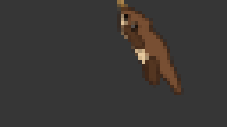
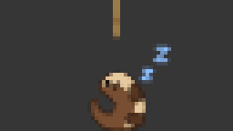
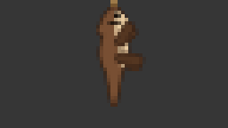
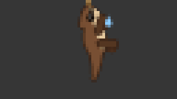
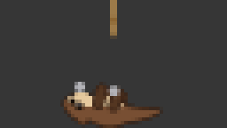

# OtterBar — Macに住むカワウソ



メニューバーに住む、ロープをくわえてぐるぐる回るコツメカワウソ。CPU 負荷が上がると速く回り、離席すると丸まって眠り、ビルドや AI エージェントの作業に反応します。

A little otter that lives in your Mac's menu bar. It spins on a rope faster as CPU load rises, curls up to sleep while you are away, and reacts to your builds and AI agents.

| 眠る | 成功で大喜び | 失敗でずっこける | エージェント作業中は石遊び |
|---|---|---|---|
|  |  |  |  |

## インストール

1. [Releases](https://github.com/kumi0708/OtterBar/releases) から `OtterBar.zip` をダウンロードして展開し、`OtterBar.app` を「アプリケーション」に移します。
2. 初回だけ、macOS の警告を回避して開きます。このアプリは Apple の公証（notarization）を受けていないため、そのままでは開けません。
   - `OtterBar.app` を開こうとして警告が出たら、システム設定 → プライバシーとセキュリティ → 「このまま開く」を押します。
   - またはターミナルで次を実行します。

     ```bash
     xattr -dr com.apple.quarantine /Applications/OtterBar.app
     ```

動作環境: macOS 26 以降（Apple Silicon / Intel）。RunCat Neo とは別アプリなので並べて使えます。

## 行動

| 状態 | きっかけ |
|---|---|
| ロープでぐるぐる | 通常。CPU 負荷で速くなる |
| 眠る → びっくりして起きる | 一定時間操作なし（初期値 5 分）→ 操作再開 |
| ビルドを応援 → 大喜び / ずっこける | ビルド開始 → 成功 / 失敗 |
| 石遊び → 手を振る | AI エージェントの作業開始 → 完了 |
| 顔洗い・キョロキョロ | 通常時にときどき |
| うとうと | 50 分以上休みなく作業したとき（休憩の合図） |

優先順位は「成功・失敗のリアクション ＞ ビルド・エージェント作業 ＞ 睡眠・起床 ＞ 通常」。設定 → ランナー → カワウソ で、いまの状態の確認、各反応の ON/OFF、眠るまでの時間の変更、反応のお試しができます。

## ビルドや AI エージェントとつなぐ

アプリは `com.otterbar.*` の Darwin 通知を受け取ります。どのツールからでも `notifyutil` で送れます。

```bash
notifyutil -p com.otterbar.build.started    # build.succeeded / build.failed / agent.started / agent.finished
```

[`otterbar/bin/otterbar`](otterbar/bin/otterbar) を使うと、コマンドの成否をそのまま伝えられます。

```bash
otterbar/bin/otterbar wrap -- make test
```

- **Claude Code**: [`otterbar/integrations/claude-code/settings.json`](otterbar/integrations/claude-code/settings.json) の `hooks` を `~/.claude/settings.json` にマージします。プロンプト送信で石遊び、応答完了で手を振ります。
- **Xcode**: Settings → Behaviors の Build Starts / Succeeds / Fails に、[`otterbar/integrations/xcode/`](otterbar/integrations/xcode) の対応するスクリプトを Run として指定します。
- **Unity**: [`OtterBarBuildHook.cs`](otterbar/integrations/unity/OtterBarBuildHook.cs) をプロジェクトの `Assets/Editor/` に置きます。

## ソースからビルド

Xcode 26.2 以降が必要です。

```bash
otterbar/build-app.sh            # otterbar/dist/OtterBar.app
otterbar/build-app.sh --install  # ~/Applications にもコピー
otterbar/build-app.sh --zip      # 配布用 zip も作る
```

カワウソの絵はすべて [`otterbar/tools/render_otter.swift`](otterbar/tools/render_otter.swift) が手続き的に描いています。ビルドのたびに実行されるので、このスクリプトを直せばアニメーションが変わります。体型やポーズの調整方法と内部構成は [OTTERBAR.md](OTTERBAR.md) を参照してください。

## プライバシー

OtterBar は外部と通信しません。離席の判定には「最後に操作してからの経過時間」だけを使い、キー入力の内容や画面は記録しません。

## クレジットとライセンス

OtterBar は [RunCat Neo](https://github.com/runcat-dev/RunCatNeo)（© Takuto Nakamura）をフォークして作られています。ライセンスは元と同じ [Apache License 2.0](LICENSE) です。元の README は [docs/RunCatNeo-README.md](docs/RunCatNeo-README.md) に残しています。
